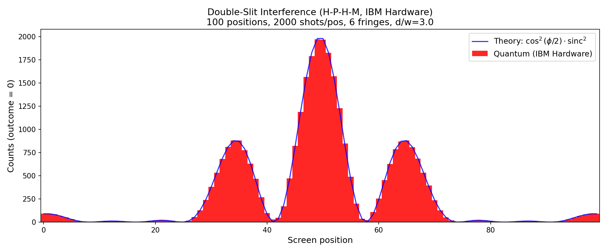

# PEARC: Double-Slit Experiment via Quantum Circuit


## Theoretical justification for the H-P-H circuit

The double-slit experiment produces an intensity pattern $I(x) = \cos^2(\phi/2)$ where
$\phi$ is the phase difference between the two paths at screen position $x$. The H-P-H
single-qubit circuit computes exactly this quantity:

1. $H|0\rangle = \frac{1}{\sqrt{2}}(|0\rangle + |1\rangle)$ --- superposition of both paths
2. $P(\phi)$ adds relative phase: $\frac{1}{\sqrt{2}}(|0\rangle + e^{i\phi}|1\rangle)$
3. Second $H$ interferes the amplitudes:
   $\frac{1}{2}(1 + e^{i\phi})|0\rangle + \frac{1}{2}(1 - e^{i\phi})|1\rangle$
4. Measurement: $P(|0\rangle) = \left|\frac{1 + e^{i\phi}}{2}\right|^2 = \cos^2(\phi/2)$

The circuit is the physical interference process in miniature: superpose $\to$ accumulate
phase $\to$ interfere. Each value of $\phi$ corresponds to one screen position. Sweeping
$\phi$ across the range $[-\pi N_f,\; \pi N_f]$ (where $N_f$ is the number of fringe
periods) reproduces the full fringe pattern.


## Post hoc $\text{sinc}^2$ envelope

The raw circuit produces pure $\cos^2$ fringes (equivalent to point-like slits). Real
slits have finite width $w$, which imposes a $\text{sinc}^2(\pi w x / \lambda L)$
diffraction envelope. This is applied as a multiplicative post-processing step on the
histogram, parameterized by the slit-width-to-separation ratio $d/w$.




## Three execution tiers

| Tier | Platform | What it demonstrates |
|------|----------|---------------------|
| 1 | Localhost (AerSimulator) | Development and validation |
| 2 | IBM cloud large VM (AerSimulator) | Scaling via cloud resources |
| 3 | IBM Quantum hardware | Real quantum execution |

All three tiers run the same `double_slit.py` code; only the `--backend` flag changes
(or the target machine for Tier 2).


## Cloud quantum stacks

Each major cloud provider has a quantum computing offering:

| Cloud | Quantum service | SDK |
|-------|----------------|-----|
| IBM | IBM Quantum | Qiskit |
| AWS | Amazon Braket | Amazon Braket SDK |
| Azure | Azure Quantum | Q# / Qiskit / Cirq |
| GCP | Google Quantum AI | Cirq |

See [CloudQuantum.md](CloudQuantum.md) for a full comparison.


## Access paths to IBM Quantum

IBM Quantum lives at [quantum.ibm.com](https://quantum.ibm.com) (or equivalently
quantum.cloud.ibm.com) --- **not** inside the general IBM Cloud console at cloud.ibm.com.
CloudBank users accustomed to navigating cloud.ibm.com will not find quantum hardware
there.


### Plan comparison

| Plan | Cost | QPU time | Best for |
|------|------|----------|----------|
| Open (free) | $0 | 10 min / 28-day rolling window | Learning, testing, small circuits |
| Pay-As-You-Go | $96/min ($1.60/sec) | Metered, no cap | One-off research runs, prototyping |
| Flex | $72/min (starts at $30k) | 400+ min/year prepaid | Project-based bursts |
| Premium | $48/min (starts annually) | 5200+ min/year | Large-scale production workloads |

**Cost estimate for our small DSE test** (50 circuits $\times$ 500 shots, single-qubit):
actual QPU execution is $\sim$25 ms, but per-job overhead brings total metered time to a
few seconds. On Pay-As-You-Go that's under $10. On the free Open plan it costs nothing
and uses a negligible fraction of the 10-minute allowance.


### Credential setup by plan

**Open Plan / Pay-As-You-Go** (both use `ibm_quantum_platform` channel):

```python
QiskitRuntimeService.save_account(
    channel="ibm_quantum_platform",
    token="YOUR_API_TOKEN",       # from quantum.ibm.com profile
    overwrite=True
)
```

**Flex / Premium** (institutional, uses `ibm_cloud` channel with CRN):

```python
QiskitRuntimeService.save_account(
    channel="ibm_cloud",
    token="YOUR_IBM_CLOUD_API_KEY",
    instance="crn:v1:bluemix:public:quantum-computing:...",
    overwrite=True
)
```


### Benefits and drawbacks

| | Open | Pay-As-You-Go | Flex/Premium |
|---|---|---|---|
| **Pro** | Free, immediate access | No commitment, scales to any workload | Lower per-minute cost, dedicated queues |
| **Con** | 10 min/month cap; shared queue (long waits, maintenance downtime) | Expensive per-minute; still shared queue | Requires contract ($30k+ entry); institutional procurement |
| **Queue priority** | Lowest | Medium | Highest |
| **Backend availability** | Subset (currently 3 systems) | More systems | Full fleet + dedicated capacity |


### CloudBank access path (ambiguous)

CloudBank [lists IBM Quantum Platform](https://www.cloudbank.org/tool/ibm-quantum-platform)
as a supported tool, but does not document the billing mechanism for quantum hardware
access. The key unresolved question:

> **Helpdesk question:** Does CloudBank provide a billing path to IBM Quantum
> Pay-As-You-Go (or Flex) plans --- i.e., can CloudBank credits be applied to IBM QPU
> time? Or is the CloudBank listing limited to pointing users at the free Open Plan?

If CloudBank covers Pay-As-You-Go, you would provision a Qiskit Runtime instance through
IBM Cloud (billed via CloudBank credits) and use the `ibm_cloud` channel with the CRN of
that instance. If not, the free Open plan is the only zero-cost option and paid access
requires separate institutional procurement or personal credit card.


### 1. Create an IBM Quantum account

**Important:** IBM Quantum is a separate portal from IBM Cloud. You will not find quantum
hardware by navigating within [cloud.ibm.com](https://cloud.ibm.com). The quantum
platform lives at [quantum.ibm.com](https://quantum.ibm.com) --- its own site with its
own dashboard, job queue, and API token. If you are coming from a CloudBank / IBM Cloud
background, go directly to quantum.ibm.com and sign in with your IBM ID (same credentials
as IBM Cloud, but a different destination).

Sign up (free). The Open Plan gives 10 minutes of QPU time per 28-day rolling window.


### 2. Get your API token

After logging in, click your profile icon (top-right) $\to$ "Account settings." Your API
token is displayed on that page. Copy it.


### 3. Install the runtime package

```bash
pip install qiskit-ibm-runtime
```

This provides `QiskitRuntimeService` (authentication + backend discovery) and the
`SamplerV2` primitive (circuit execution).


### 4. Save your credentials (one-time)

```python
from qiskit_ibm_runtime import QiskitRuntimeService

QiskitRuntimeService.save_account(
    channel="ibm_quantum_platform",
    token="YOUR_API_TOKEN_HERE",
    overwrite=True
)
```

This writes credentials to `~/.qiskit/qiskit-ibm.json`. You only need to do this once.


### 5. Connect and select a backend

```python
from qiskit_ibm_runtime import QiskitRuntimeService

service = QiskitRuntimeService()
backend = service.least_busy(operational=True, simulator=False)
print(f"Backend: {backend.name}, qubits: {backend.num_qubits}")
```

`least_busy` picks the backend with the shortest queue. For a specific machine:

```python
backend = service.backend("ibm_brisbane")
```


### 6. Transpile for the target hardware

```python
from qiskit import transpile

# circuits = list of H-P-H-M circuits from build_circuits()
transpiled = transpile(circuits, backend, optimization_level=1)
```

Transpilation maps your abstract gates to the backend's native gate set and qubit
connectivity. For single-qubit circuits this is trivial but still required.


### 7. Submit via SamplerV2

```python
from qiskit_ibm_runtime import SamplerV2

sampler = SamplerV2(backend)
job = sampler.run(transpiled, shots=1000)
print(f"Job ID: {job.job_id()}")
```

The job enters the queue. Free-tier wait times range from seconds to hours depending on
demand.


### 8. Retrieve results

```python
result = job.result()

for i in range(len(transpiled)):
    pub_result = result[i]
    counts = pub_result.data.c.get_counts()
    # counts is e.g. {'0': 823, '1': 177}
```


### 9. Run via double_slit.py (all-in-one)

With credentials saved, the entire workflow is:

```bash
python double_slit.py --backend ibm --screen-pts 100 --fringes 5 --shots-per-pos 500
```

This builds 100 circuits, submits them to the least-busy backend, waits for results,
applies the $\text{sinc}^2$ envelope, and saves the histogram and JSON.


### Notes on IBM hardware execution

- **Noise sources on real hardware:**
  - *Shot noise* (both simulator and hardware): Statistical fluctuation from finite
    sampling. With $N$ shots per position, uncertainty scales as $1/\sqrt{N}$. This is
    intrinsic to quantum mechanics, not a hardware defect.
  - *Decoherence* ($T_1$ relaxation, $T_2$ dephasing): The qubit's environment becomes
    entangled with it over time, causing energy loss ($T_1$) and phase randomization
    ($T_2$). Mathematically equivalent to an uncontrolled measurement by the environment
    --- the density matrix's off-diagonal elements decay. Longer circuits suffer more.
  - *Gate errors*: Each physical microwave pulse implementing a gate has small
    imperfections ($\sim 10^{-3}$ per single-qubit gate, $\sim 10^{-2}$ per two-qubit
    gate). Errors compound with circuit depth.
  - *Readout errors*: The detector occasionally misidentifies $|0\rangle$ as $|1\rangle$
    or vice versa ($\sim 1\text{--}2\%$). This smears all probabilities toward 50/50.
  - *For our H-P-H circuit*: Only 3 gates, single qubit, no two-qubit gates. Decoherence
    barely accumulates. Dominant noise is readout error. Expect a clearly visible
    $\cos^2$ pattern with slightly reduced contrast versus the simulator.
- **Maintenance:** If the script warns that a backend is "in maintenance," cancel and
  retry later. Jobs submitted to a maintenance backend sit indefinitely. Check live
  system status at [quantum.ibm.com/services/resources](https://quantum.ibm.com/services/resources).
- **Available regions:** `us-east` and `eu-de` only. No US-west option exists.
- **Queue times:** Can be long on the free tier. Submit during off-peak hours (US
  late night / early morning) for shorter waits.
- **Error rates:** Real hardware has gate errors ($\sim 10^{-3}$ for single-qubit gates)
  and readout errors ($\sim 10^{-2}$). The $\cos^2$ pattern will be noisier than the
  simulator but clearly visible.
- **Transpilation matters:** Even for 1-qubit circuits, always transpile. The backend may
  not support the abstract $P$ gate directly.
- **Sessions:** For batch execution, use a Session context to keep your circuits grouped
  and reduce queue overhead:

```python
from qiskit_ibm_runtime import Session

with Session(service=service, backend=backend) as session:
    sampler = SamplerV2(session=session)
    job = sampler.run(transpiled, shots=1000)
    result = job.result()
```


## Measuring noise: simulator vs real hardware

The simulator and real quantum hardware both produce the $\cos^2(\phi/2)$ interference
pattern, but with different kinds of imperfection. Running the same experiment on both
and comparing the results reveals exactly what real quantum hardware adds to the picture.


### What "noise" means here

Think of noise as anything that makes the measured result differ from the theoretical
prediction. There are two flavors:

**Shot noise** (both simulator and hardware): Even a perfect device produces randomness.
Each measurement is like flipping a biased coin --- you know the probability of heads is
$\cos^2(\phi/2)$, but any finite number of flips will scatter around that value. This is
fundamental to quantum mechanics and unavoidable. The more shots you take, the closer your
average gets to the true probability (the scatter shrinks as $1/\sqrt{N}$).

**Hardware noise** (real devices only): On top of the coin-flip randomness, real hardware
introduces systematic distortions:

- The "coin" is slightly miscalibrated (readout errors: the detector sometimes says
  "heads" when the qubit was "tails," or vice versa, at a rate of roughly 1--2%)
- The qubit loses energy to its environment between gates ($T_1$ decay: biases results
  toward $|0\rangle$)
- Gate pulses are imperfect (small rotation-angle errors accumulate)

These effects wash out the fringe pattern: the bright peaks get slightly dimmer, and the
dark troughs never quite reach zero.


### The experiment

Run the double-slit circuit with identical parameters on both backends:

```bash
# Step 1: Run on the local simulator
python double_slit.py --backend local --screen-pts 100 --fringes 6 --shots-per-pos 2000

# Step 2: Run on IBM hardware (free tier, when a backend is active)
python double_slit.py --backend ibm --screen-pts 100 --fringes 6 --shots-per-pos 2000

# Step 3: Compare the results
python noise_analysis.py
```

Step 3 reads both result files (`double_slit_results_local.json` and
`double_slit_results_ibm.json`) and computes several metrics. The output goes to the
terminal and is also saved to `simulator_to_ibm_quantum_noise_analysis.txt`.


### What the analysis measures

**Fringe visibility** --- How much contrast is there between the bright and dark fringes?
Defined as $V = (P_\text{max} - P_\text{min})/(P_\text{max} + P_\text{min})$. A perfect
device gives $V = 1$ (peaks at 1, troughs at 0). Readout errors and decoherence reduce
$V$ by pushing the peaks down and the troughs up. The simulator should give $V$ very close
to 1; hardware will give something lower.

**Bias at dark fringes** --- At positions where theory predicts zero detections, does the
hardware still register some? If so, that's the readout error rate made directly visible.
The simulator should show values near zero at these positions (just shot noise); hardware
will show a small positive floor.

**Chi-squared** --- A standard statistical test for "does the data match the theory?" It
sums up the squared differences between observed and expected values, weighted by the
expected variance. A score near 1 (per degree of freedom) means the noise is exactly what
you'd expect from random coin-flipping. A score much greater than 1 means something
systematic is going on beyond pure randomness. The simulator should score near 1; hardware
will score higher.

**Excess variance** --- Is the scatter in the data bigger than pure coin-flip statistics
would predict? A ratio of 1.0 means the noise is exactly binomial (shot noise only). A
ratio greater than 1.0 means the hardware is adding extra randomness on top. This extra
noise comes from gate errors and environmental interference.

**Residuals** --- The difference between each measured value and the theoretical
prediction. For the simulator, these should average to zero (no bias). For hardware, a
positive average at dark fringes (and/or negative at bright fringes) is the fingerprint
of readout error compressing everything toward 50/50.


### Expected results

| Metric | Simulator | Hardware |
|--------|-----------|----------|
| Visibility $V$ | $\approx 1.00$ | $\approx 0.95\text{--}0.98$ |
| Bias at dark fringes | $\approx 0$ | $\approx 0.01\text{--}0.02$ |
| Chi-squared / dof | $\approx 1.0$ | $> 1.5$ |
| Variance ratio | $\approx 1.0$ | $> 1.0$ |

The magnitude of the hardware effects depends on which backend you get and its
calibration state on that day. IBM publishes per-backend error rates at
[quantum.ibm.com](https://quantum.ibm.com) under each system's detail page.


### Why this matters

This comparison demonstrates that quantum hardware is not just a simulator running
somewhere else. The physics is real: the qubit interacts with its environment in ways a
classical random number generator does not. The noise signature is the proof that
something genuinely quantum-mechanical is happening --- and also the reason error
correction is an active area of research.
