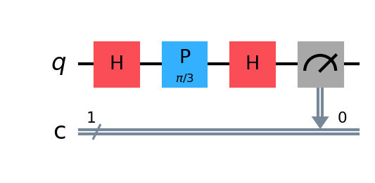

# Q7: Double slit experiment (DSE)


## The physical apparatus


A red laser pointer ($\lambda = 650$ nm) illuminates a double-slit slide. The light 
passes through two narrow slits separated by distance $d$, propagates to a screen at 
distance $L$, and produces an interference pattern: alternating bright and dark fringes.


### Geometry

```
     slit A ─────┐
                  │  d (slit separation)
     slit B ─────┘
                          L (slit-to-screen distance)
         ──────────────────────────────────► screen
```


There are two important points of emphasis: First the fringes are built up from individual
photon detections, registering to our eye or a detector as pinpricks of red light. Second
this apparatus is described in terms of a red laser pointer that produces a tremendous 
number of light particles (photons) per second; so we might infer that the photons 
"bump into" one another in some fashion to produce the interference pattern; but in fact
the experimentalists assure us that the same pattern arises when the photons are
released one at a time.


At a point on the screen at angle $\theta$ from the centerline, the path-length 
difference between light from slit A and slit B is:


$$\Delta = d \sin\theta$$


For small angles ($\sin\theta \approx \tan\theta = x/L$ where $x$ is position on screen):


$$\Delta \approx \frac{d \, x}{L}$$


### Interference condition


Constructive interference (bright fringe) when $\Delta = m\lambda$ for integer $m$:


$$x_m = \frac{m \lambda L}{d}$$


Destructive interference (dark fringe) when $\Delta = (m + 1/2)\lambda$:


$$x_{\text{dark}} = \frac{(m + 1/2)\lambda L}{d}$$


The fringe spacing (distance between adjacent bright fringes) is:


$$\Delta x = \frac{\lambda L}{d}$$


### Concrete numbers for a red laser pointer


**Laser:** Midwest Laser Products model LL12, 2 mW, manufactured 1998, $\lambda = 650$ nm.

**Double-slit slide:** 3B Scientific part 1000596 (British/German educational optics).
Three double-slit pairs with varying slit width $b$ and constant divider width ~0.10 mm:

| Pair | Slit width $b$ | Divider | Center-to-center $d$ | Fringe spacing at 1.5 m |
|------|---------------|---------|---------------------|------------------------|
| 1 | 0.10 mm | 0.10 mm | 0.20 mm | 4.88 mm |
| 2 | 0.15 mm | 0.10 mm | 0.25 mm | 3.90 mm |
| 3 | 0.20 mm | 0.10 mm | 0.30 mm | 3.25 mm |

**Key result:** At $L = 1.5$ m screen distance, all three pairs produce
**> 2 fringes per cm** — easily visible to a conference audience without magnification.

**Best choice for demo:** Slit pair 1 ($b = 0.10$ mm, $d = 0.20$ mm) — widest fringes
(4.88 mm spacing, ~2 per cm) and broadest diffraction envelope (narrowest slit $\to$ most
fringes visible).


### The intensity pattern


The full intensity pattern for two slits of finite width $w$ is:


$$I(x) = I_0 \cos^2\left(\frac{\pi d x}{\lambda L}\right) \cdot \text{sinc}^2\left(\frac{\pi w x}{\lambda L}\right)$$


- The $\cos^2$ factor: **interference** between the two slits (oscillating fringes)
- The $\text{sinc}^2$ factor: **diffraction** from each individual slit (envelope)


With $w \ll d$ the envelope is broad and many fringes are visible. With $w \approx d$ 
only a few central fringes survive before the envelope suppresses them.


### Why $\cos^2 \times \text{sinc}^2$: derivation from first principles

The intensity pattern is the *squared magnitude* of the total electric field amplitude 
at the screen. The amplitude is the sum of contributions from all points within both slits.

**Step 1: A single slit of width $w$.**

A rectangular slit centered at the origin contributes an amplitude at screen position $x$:

$$A_{\text{single}}(x) = \int_{-w/2}^{w/2} e^{i k s \sin\theta} \, ds$$

where $k = 2\pi/\lambda$ and $s$ is the coordinate along the slit. For small angles 
($\sin\theta \approx x/L$) this evaluates to:

$$A_{\text{single}}(x) = w \cdot \text{sinc}\left(\frac{\pi w x}{\lambda L}\right)$$

The sinc function is $\text{sinc}(u) = \sin(u)/u$. It arises because we are taking the 
Fourier transform of a rectangular (top-hat) function — and the FT of a rectangle is a 
sinc. The intensity from one slit alone is $|A_{\text{single}}|^2 \propto \text{sinc}^2$.

**Step 2: Two slits separated by $d$ (center-to-center).**

Slit A is centered at $+d/2$, slit B at $-d/2$. Each contributes the same single-slit 
amplitude, but shifted in phase by the path-length difference:

$$A_{\text{total}}(x) = A_{\text{single}}(x) \cdot e^{i\pi dx/(\lambda L)} + A_{\text{single}}(x) \cdot e^{-i\pi dx/(\lambda L)}$$

Factor out the common single-slit envelope:

$$A_{\text{total}}(x) = A_{\text{single}}(x) \cdot 2\cos\left(\frac{\pi d x}{\lambda L}\right)$$

The two exponentials combine into a cosine — this is **interference** between the two 
paths.

**Step 3: Intensity is amplitude squared.**

$$I(x) = |A_{\text{total}}|^2 = 4 |A_{\text{single}}|^2 \cdot \cos^2\left(\frac{\pi d x}{\lambda L}\right)$$

$$= 4 w^2 \, \text{sinc}^2\left(\frac{\pi w x}{\lambda L}\right) \cdot \cos^2\left(\frac{\pi d x}{\lambda L}\right)$$

So the product structure is not arbitrary — it follows directly from the physics:

- **$\cos^2$**: two sources interfering (sum of two phasors with position-dependent 
  phase difference). This produces the rapid oscillating fringes.
- **$\text{sinc}^2$**: each source is extended (not a point) so its own radiation 
  pattern has angular structure. This provides the broad envelope.

The two factors are *independent*: the cosine comes from the slit *separation* $d$, 
the sinc comes from the slit *width* $w$. The ratio $d/w$ determines how many fringes 
fit inside the central diffraction lobe before the sinc zeros kill them.

**The counting rule:** The sinc envelope has its first zero when 
$\pi w x / (\lambda L) = \pi$, i.e. at fringe position $x_0 = \lambda L / w$. The 
fringe spacing is $\Delta x = \lambda L / d$. Number of fringes from center to first 
zero: $x_0 / \Delta x = d/w$. Total bright peaks in the central lobe: $2(d/w) - 1$ 
(approximately, depending on whether a fringe lands exactly at the zero or between 
zeroes).

For the physical slit pair 1 ($d = 0.20$ mm, observed 5 peaks): this implies an 
effective $d/w \approx 3$, suggesting $w \approx 0.067$ mm (the actual aperture may be 
narrower than the labeled 0.10 mm, or the effective aperture is reduced by the slit 
edge geometry).


## Mapping to a quantum circuit


### The conceptual translation

| Physical system | Quantum circuit |
|----------------|----------------|
| Photon taking two paths (slits) | Superposition in momentum space |
| Path-length difference → phase | Phase differences between basis states |
| Interference at the screen | QFT converts phase structure to position probabilities |
| Detector screen (continuous) | Discrete screen register ($2^k$ bins) |
| Fringe pattern $I(x)$ | Measurement histogram |


### The discrete model

We discretize the screen into $N = 2^k$ bins. The continuous fringe pattern becomes:

$$P(x) = \cos^2\left(\frac{2\pi d \, x}{N}\right) \cdot \text{envelope}(x)$$

where $x \in \{0, 1, \ldots, N-1\}$ is the bin index and $d$ is the slit separation 
measured in units of the fundamental spatial frequency $1/N$.

The number of visible fringes across the screen is controlled by $d$: with $d = 3$ 
you get 6 peaks (since $\cos^2$ has period $N/d$ and two peaks per period).


### Why the QFT is necessary

The double-slit pattern is fundamentally a Fourier relationship: two point sources in 
"momentum space" (the slit plane) produce a cosine modulation in "position space" 
(the screen). This is the same relationship as in Q3 — conjugate bases connected by 
Fourier transform.

In the quantum circuit:

1. **Prepare the state in momentum space:** Initialize the screen register as a 
   superposition representing two slit positions (two peaks in the "momentum" 
   representation).

2. **Apply the QFT:** This converts the momentum-space state to position-space — 
   exactly as the free propagation of light from slits to screen performs a 
   physical Fourier transform (Fraunhofer diffraction is literally a spatial FT).

3. **Measure in position space:** Each measurement outcome is one "photon hit" on 
   the screen. Accumulated statistics reproduce the $\cos^2$ pattern.

Without the QFT, the state remains in momentum space and measurement would just 
reveal which slit the photon came from — no interference pattern.


### The circuit in detail

```
Registers:
  screen: k qubits (detector position, 2^k bins)

Steps:
  1. Initialize: prepare |ψ_momentum⟩ — a superposition encoding two
     Gaussian slits at positions d and N-d in momentum space.
     
     ψ(p) = A · [exp(-(p-d)²/2w²) + (-1)^p · exp(-(p-(N-d))²/2w²)]
     
     The (-1)^p factor shifts the position-space pattern to the center
     of the screen (discrete Fourier shift theorem).

  2. QFT: Apply the quantum Fourier transform to convert from momentum
     basis to position basis. This is decomposed into H gates and 
     controlled-phase (CP) gates:
     
     - For each qubit j (from MSB to LSB):
       - Apply H
       - Apply CP(π/2^(j-k)) between qubit k and qubit j, for all k < j
     - Reverse qubit order (SWAP gates)

  3. Measure: all screen qubits in the computational basis.
     Each shot → one bin index → one "photon detection."
```


### Finite slit width and the envelope

Point-like slits (delta functions in momentum space) produce pure $\cos^2$ fringes 
with no falloff — all peaks are the same height. This is unrealistic.

Real slits have finite width $w$. In the circuit, this is encoded by replacing the 
delta functions with Gaussians of width $w$ in momentum space. After QFT, the 
Fourier uncertainty principle ($\sigma_x \cdot \sigma_p \geq 1/2$) ensures that 
the position-space pattern has a Gaussian envelope:

$$\text{envelope width} = \frac{N}{2\pi w}$$

Narrower slits ($w$ small) → broader envelope → more visible fringes.
Wider slits ($w$ large) → narrower envelope → fewer visible fringes.

This is the discrete analog of the $\text{sinc}^2$ diffraction envelope in the 
continuous case.


### Correspondence between physical and circuit parameters


| Physical parameter | Circuit parameter | Relationship |
|-------------------|-------------------|--------------|
| Slit separation $d_{\text{phys}}$ | `slit_separation` ($d$) | Fringes: $N/d$ bins per fringe period |
| Slit width $w_{\text{phys}}$ | `slit_width` ($w$) | Envelope: wider $w$ → fewer fringes visible |
| Screen resolution | `n_screen_qubits` ($k$) | $N = 2^k$ bins |
| Number of photons | `shots` | Statistical quality of histogram |
| Wavelength $\lambda$ | (absorbed into $d$) | Sets the fringe spacing via $d$ |


The wavelength does not appear explicitly in the circuit because we work in 
dimensionless units: $d$ directly controls how many fringes fit across the $N$-bin 
screen. The physical wavelength determines $d$ through:


$$d = \frac{d_{\text{phys}} \cdot N}{\lambda L / \Delta x_{\text{bin}}}$$


For the PEARC demo this mapping is pre-computed: we choose $d$ and $w$ to produce a 
visually appealing pattern with 5–7 visible fringe peaks, matching what the audience 
sees from the laser on the table.


## A Dialog on the simple DSE H-P-H-M circuit


xxxxxxxxxxxxxxxxxxxxxxxxxxxxxxxxxxxxxxx


Critique of this section:


Incomplete derivation after "Applying H:" — The answer to "What does the second H do?" trails off. It says "Applying H:" and then jumps to the result $P(|0\rangle) = |1 + e^{i\phi}|^2/4 = \cos^2(\phi/2)$ without showing the intermediate matrix multiplication. Not wrong per se, just a gap.


$P(|0\rangle)$ notation — In that same spot, $P(|0\rangle)$ is used to mean "probability of measuring $|0\rangle$." This is potentially confusing because earlier in the document $P(\phi)$ denotes the phase gate. A different symbol for probability (like $\text{Pr}(0)$ or $p_0$) would avoid ambiguity.


The factor is $1/4$ but should show it equals $\cos^2(\phi/2)$ more explicitly. The expression $|1 + e^{i\phi}|^2/4$ is correct, but it might read as though the squared amplitude is $|1+e^{i\phi}|^2$ divided by 4 from somewhere mysterious. The 4 comes from $|1/2|^2 \cdot |1+e^{i\phi}|^2$, i.e. the $1/2$ prefactor squared gives $1/4$. This is stated correctly in the "Deciphering the circuit" subsection below where the amplitude $\frac{1}{2}(1 + e^{i\phi})$ is explicit — so the logic is present, just out of order.


The Bloch sphere paragraph states $P(|0\rangle) = (1/\sqrt{2})^2 = 1/2$ for a point on the equator. That's correct, but it's worth noting that $(1/\sqrt{2})^2 = 1/2$ is the squared amplitude, not $\cos^2(\theta/2)$ directly. For equatorial points $\theta = \pi/2$, so $\cos^2(\pi/4) = 1/2$ — same answer, consistent. No error, just confirming.


xxxxxxxxxxxxxxxxxxxxxxxxxxxxxxxxxxxxxxxxxxxxxxxxxxxx


### Tracing basis vectors


Let's observe that a state has multiple representations with respect to the
$z$ basis. It is in general $\alpha |0\rangle + \beta |1\rangle$ so let's 
first trace through what happens to the basis vectors themselves, where 
$\alpha = 1; \; \beta = 0$ for $|0\rangle$ and $\alpha = 0; \; \beta = 1$ 
for $|1\rangle$. 


$|0\rangle = [1, 0]^T$ which could be written $(1, 0)$ in $\mathbb{R}^2$. 
$|1\rangle = [0, 1]^T$ which could be written $(0, 1)$ in $\mathbb{R}^2$.
More practical is placing $\alpha$ and $\beta$ in two complex unit discs to
effect $\mathbb{C}^2$. 


**Q**: Where do the two basis vectors go in $\mathbb{C}^2$? 


**A**: $|0\rangle = [1, 0]^T$ has complex amplitude $1 + 0i$ for the first component and $0 + 0i$ for the second. $|1\rangle = [0, 1]^T$ is origin on disk 1, rightmost point (1 + 0i) on disk 2.


**Q**: Where do the two basis vectors go on the Bloch sphere? 


**A**: $|0\rangle$ maps to $(0, 0, 1)$ by virtue of colatitude 
$\theta = 2 \arccos{r_\alpha} = 0$.
Likewise $|1\rangle$ maps to $(0, 0, -1)$ as $r_\alpha$ is now 0. That is: $|1\rangle$ has a Bloch angle $\theta = 2 * \arccos{r_\alpha} = 2 * \arccos{0} = 2 * \pi/2 = \pi$. This is how the second basis vector ends up at $(0, 0, -1)$ with a colatitude of $\pi$. 


The Bloch sphere can be challenging to visualize. For one thing it represents two 
degrees of freedom while $\mathbb{C}^2$ has four. But one degree of freedom is lost 
due to the requirement that the sum of the squares of the complex amplitudes must 
equal $1$ (equivalently: The state is a unit vector); and another degree of freedom
is lost because a global phase $\gamma$ applied to the state as a phasor $e^{i \gamma}$
has no physical meaning. Consequently this is a degree of freedom that need not
register in the Bloch sphere.


### Quantum circuit components





Now we turn to some of the mechanics of the quantum circuit that claims to 
represent the DSE.


**Q**: Is the single qubit for this circuit initially in $|0\rangle$? 


**A**: Yes: All qubits start in $|0\rangle$ by convention in Qiskit.


**Q**: What is the double "C" line in the quantum circuit diagram? 


**A**: That's the classical information ("C") bit register that carries a measurement result 0 or 1 after 
a qubit is measured. It is drawn as a double line to distinguish it from the quantum 
(qubit) wire. Classical bits are allocated when we write code `QuantumCircuit(1, 1)`. This
translates to "1 qubit, 1 classical bit". The adjacent `1` at the left side is the register size.


**Q**: Why is there a 0 above the double line at the extreme right? 


**A**: That's the bit index for that measurement result. This qubit measurement outcome is stored in
classical bit `0`. The connector arrow from the qubit to the classical line indicates a measurement 
operation. The index mapping of qubit to classical result bit is done as arguments of the qiskit 
`qc.measure()` call. 


**Q**: How does the code implement the $P$ gate operator after the initial Hadamard gate?


The $P$ gate effects an arbitrary rotation about the Z axis in the Bloch sphere: By angle $\phi$.
The code loops over these values of $\phi$ by means of a numpy array: 


```
phi_vals = np.linspace(-np.pi * num_fringes, np.pi * num_fringes, screen_points)
```


That is: Each $\phi$ value corresponds to a detector location on the screen. A large
number of shots are issued at each value of $\phi$ and the number of `1` measurements
accumulates in the screen histogram. (At this time a post hoc sinc function is applied
to simulate the broader null envelope due to the two slits having finite width.) 

### H P H calculation


We want to understand the probabilities of measuring $|0\rangle>$ and 
$|1\rangle$ from the state $H(P_{\phi}(H(|0\rangle>)))$. In words:
take a qubit in the $|0\rangle$ basis state, pass it through three gates
that involve a parameter angle $\phi$ (that will induce quantum interference)
and measure the result. We progress through the calculation one gate at a
time... but this also suggests combining the gates first.


**Q**: How does $H$ put $|0\rangle$ into $|+\rangle$?


**A**: The Hadamard Gate as a matrix is 


$$H = \frac{1}{\sqrt{2}} \begin{pmatrix} 1 & 1 \\ 1 & -1 \end{pmatrix}$$


This rotates the state vector $\pi$ radians about the 45-degree axis between
the Z axis and X axis on the Bloch sphere. Since $|0\rangle$ is along +Z
this rotation brings it to the +x or $|+\rangle$ axis. The corresponding state 
vector is evenly split between the z-basis vectors: 
$H |0\rangle = \frac{1}{\sqrt{2}} \; \left( |0\rangle + |1\rangle \right)$. 


A further detail: The upper row of $H$ is $(1, 1)$ which is (to strain one's
credulity) the constant kernel of a two-element Fourier transform. It is just
going to add the two components of the vector it operates upon, like an average
without the divide-by-2 part. This is like a Fourier kernel that goes through
an angle of $2 \pi$ from one term to the next. Then the second row goes through
an angle of $2 \pi / 2 = \pi$ between elements: The first non-stationary
frequency kernel.


**Q**: What does $P_\phi$ do? 


**A**: The notation I use for the state of the system is $\alpha |0\rangle + \beta |1\rangle$
where $\alpha$ and $\beta$ are both complex (though at the moment they are both $1/\sqrt{2}$.)
Both have magnitudes: $r_\alpha$ and $r_\beta$. Both have phases: Respectively
$\eta$ and $\nu$. The phase difference $\nu - \eta$ is registered as the azimuthal
angle on the Bloch sphere. The colatitude $\theta$ is derived from the magnitude
of $\alpha$: $theta = 2 \cdot \arccos{r_\alpha}$. I will keep returning to these
values in the course of this calculation to anchor the arithmetic to definite values.


The $P$ matrix is a generalization of the $\sigma_z$ matrix: 


$$P_{\phi} = \begin{pmatrix} 1 & 0 \\ 0 & e^{i \phi} \end{pmatrix}$$


So $P_\phi$ leaves $\alpha$ unchanged in the $|0\rangle$ component of the state.
The second row multiplication does not bring in any of $\alpha$ to the $|1\rangle$
component. It does multiply the $\beta$ coefficient by a phasor $e^{i\phi}$.
So in the current calculation:


$$P_\phi∣+⟩ = \frac{1}{\sqrt{2}}(|0\rangle + e^{i \phi}|1\rangle)$$


As a specific example take $\phi = \pi / 2$:


$$P_{\pi/2}∣+⟩ = \frac{1}{\sqrt{2}}(|0\rangle + e^{\frac{i \pi}{2}}|1\rangle) = \frac{1}{\sqrt{2}}(|0\rangle + i|1\rangle) = |+i\rangle$$


That is, the state in the Bloch sphere is now a unit vector along the +Y axis. This has
an $r_\alpha$ of $1/\sqrt{2}$ and a phase difference $\nu - \eta = \pi/2$.


**Q**": What does the second H do? 


**A**: It interferes the two path components. After $P_\phi$ the state is 
$\frac{1}{\sqrt{2}}(|0\rangle + e^{i\phi}|1\rangle)$. Applying H:


So $P(|0\rangle) = |1 + e^{i\phi}|^2/4 = \cos^2(\phi/2)$. The second H converts the phase information (which is invisible to Z-measurement) into amplitude information (which Z-measurement can read). This is the interference step.


#### Deciphering the circuit


With just one qubit this circuit does not feature entanglement. We *do* have quantum interference.


Quantum interference is a sum of two complex amplitudes before squaring, wherein relative phase 
affects probability.


In this circuit the state after $H-P$ is $\frac{1}{\sqrt{2}}(|0\rangle + e^{i\phi}|1\rangle)$. 


The second H adds the two complex amplitudes:


Amplitude for final $|0\rangle$: $\frac{1}{2}(1 + e^{i\phi})$.


Amplitude for final $|1\rangle$: $\frac{1}{2}(1 - e^{i\phi})$.


The "interference" is that $+$ and $-$ in the amplitude sums. When $\phi = 0$: the $|0\rangle$ amplitudes add constructively ($1 + 1 = 2$) and the $|1\rangle$ amplitudes cancel destructively ($1 - 1 = 0$). When $\phi = \pi$: the opposite. For intermediate φ: partial constructive/destructive interference. This is the same physics as two wave crests arriving in phase (constructive) or out of phase (destructive) at a point on the screen.

The word "interference" means: two complex amplitudes being summed before squaring, so their relative phase affects the probability. Classical probabilities just add. Quantum amplitudes add — then you square — so phases matter.


A measurement ('collapse') operates on a state vector. This state vector can be envisioned as 
'somewhere on the Bloch sphere' or 'two points on the $\mathbb{C}^2$ double disk'. For 
the probability measurement Bloch serves well by means of the state colatitude angle $\theta$.
We have $P(|0\rangle) = \cos^{2} (\theta / 2)$. For a point on the Bloch equator we have
$P(|0\rangle)=(1 / \sqrt{2})^2=1/2$. For a point nearer to $|0\rangle$ with $\theta = \pi/3$
we have $P(|0\rangle) = \cos^{2}(\pi/6) = 3/4$. For a point near $|0\rangle$ with $\theta = \pi/6$
we have $P(|0\rangle) \approx 0.933$. 


#### Measurement


**Q**: What distinguishes $\sigma_z$ used for measurement from $\sigma_z$ used as a gate? 


**A**: In Qiskit code:

```
# As a GATE (unitary, reversible, deterministic):
qc.z(0)   # applies sigma_z to qubit 0 — negates the |1⟩ phase

# As a MEASUREMENT (irreversible, probabilistic, extracts classical info):
qc.measure(0, 0)  # measures qubit 0 in the Z basis, stores result in classical bit 0
```

The gate `qc.z(0)` transforms the state and the quantum circuit continues. The measurement 
`qc.measure(0, 0)` collapses the state to $|0\rangle$ or $|1\rangle$ and writes a classical 
bit. Different operations, same basis (Z eigenstates), different Qiskit calls.


#### The measurement process per shot

Measurement in the computational basis ($Z$-basis) produces outcome 0 or 1 each shot.
For a state $|\psi\rangle = \alpha|0\rangle + \beta|1\rangle$:

**The measurement operators** are the projectors onto the eigenstates of $\sigma_z$:

$$P_0 = |0\rangle\langle 0| = \begin{pmatrix} 1 & 0 \\ 0 & 0 \end{pmatrix}, \quad P_1 = |1\rangle\langle 1| = \begin{pmatrix} 0 & 0 \\ 0 & 1 \end{pmatrix}$$

**Constructing the projector:** $|0\rangle$ is the column vector
$\begin{pmatrix} 1 \\ 0 \end{pmatrix}$ and $\langle 0|$ is its conjugate transpose, the
row vector $\begin{pmatrix} 1 & 0 \end{pmatrix}$. Their product $|0\rangle\langle 0|$ is a
matrix multiplication of a $(2 \times 1)$ matrix times a $(1 \times 2)$ matrix: four
scalar multiplications producing a $(2 \times 2)$ matrix:

$$|0\rangle\langle 0| = \begin{pmatrix} 1 \\ 0 \end{pmatrix} \begin{pmatrix} 1 & 0 \end{pmatrix} = \begin{pmatrix} 1 \cdot 1 & 1 \cdot 0 \\ 0 \cdot 1 & 0 \cdot 0 \end{pmatrix} = \begin{pmatrix} 1 & 0 \\ 0 & 0 \end{pmatrix}$$

**In contrast:** $\langle 0|0\rangle$ is an inner product of two vectors in the Hilbert
space --- a $(1 \times 2)$ row vector times a $(2 \times 1)$ column vector producing a
scalar:

$$\langle 0|0\rangle = \begin{pmatrix} 1 & 0 \end{pmatrix} \begin{pmatrix} 1 \\ 0 \end{pmatrix} = 1 \cdot 1 + 0 \cdot 0 = 1$$

The outer product $|0\rangle\langle 0|$ is an operator (a matrix that acts on vectors).
The inner product $\langle 0|0\rangle$ is a scalar (the overlap between two states).

**Probability of outcome 0:**

$$\text{Pr}(0) = \langle\psi|P_0|\psi\rangle = |\alpha|^2$$

**Probability of outcome 1:**

$$\text{Pr}(1) = \langle\psi|P_1|\psi\rangle = |\beta|^2$$

**What $\langle\psi|P_0|\psi\rangle$ is doing:** This is a "sandwich" expression. You can
evaluate it either way by associativity: $({\langle\psi|}P_0){|\psi\rangle}$ first applies
$\langle\psi|$ to $P_0$ producing a row vector, then dots with $|\psi\rangle$; or
$\langle\psi|(P_0|\psi\rangle)$ first applies $P_0$ to $|\psi\rangle$ producing a column
vector, then takes the inner product with $\langle\psi|$. Both give the same scalar.
Matrix multiplication is associative, so the grouping does not matter.

**Post-measurement state** (if outcome is $k$):

$$|\psi\rangle \;\xrightarrow{\text{outcome } k}\; \frac{P_k|\psi\rangle}{\sqrt{\langle\psi|P_k|\psi\rangle}}$$

So explicitly:

- Outcome 0: state collapses to $|0\rangle$ (the $\beta$ component is annihilated)
- Outcome 1: state collapses to $|1\rangle$ (the $\alpha$ component is annihilated)


#### Simulator versus hardware

**On the simulator (AerSimulator):** The simulator maintains the state vector
$[\alpha, \beta]$ as two complex numbers in memory. To produce a measurement outcome it
computes $|\alpha|^2$, draws a uniform random number via `random.random()`, and returns 0
if the random number is less than $|\alpha|^2$, else 1. There is no actual construction
of $\langle\psi|P_0|\psi\rangle$ as a matrix--vector--vector product. The simulator
already *has* $\alpha$ directly, so it just squares its magnitude and rolls the dice.

**On IBM quantum hardware:** There is no state vector in memory. The physical qubit
*is* the superposition. The measurement is a microwave pulse that couples the qubit to a
readout resonator. The resonator's response frequency depends on whether the qubit is in
$|0\rangle$ or $|1\rangle$. A discriminator circuit classifies the analog signal into a
binary 0 or 1. Nature "rolls the dice" --- the Born rule $\text{Pr}(0) = |\alpha|^2$ is
not computed but *enacted* by the physics of wave function collapse. The hardware produces
the same statistics as the simulator's random number generator, but through fundamentally
different means: physical measurement versus classical sampling from a known distribution.


### Constructing an operator

Rather than presenting operators as given, we can *derive* them from the desired
geometric action on the Bloch sphere.


#### The Hadamard gate: rotation about the XZ diagonal

**Desired action:** We want a gate that swaps the $Z$-axis poles with the $X$-axis poles
on the Bloch sphere. Specifically: $|0\rangle \to |+\rangle$ and $|1\rangle \to |-\rangle$.
Geometrically this is a 180$^\circ$ rotation about the axis halfway between $\hat{x}$ and
$\hat{z}$ --- the unit vector $\hat{n} = \frac{1}{\sqrt{2}}(\hat{x} + \hat{z})$.

**The rotation formula:** A rotation by angle $\theta$ about axis $\hat{n}$ on the Bloch
sphere corresponds to the unitary:

$$U = \cos(\theta/2)\, I - i\sin(\theta/2)\, (\hat{n} \cdot \vec{\sigma})$$

where $\vec{\sigma} = (\sigma_x, \sigma_y, \sigma_z)$ are the Pauli matrices.

**Plug in:** $\theta = \pi$ (half-turn), $\hat{n} = \frac{1}{\sqrt{2}}(1, 0, 1)$:

$$U = \cos(\pi/2)\, I - i\sin(\pi/2)\cdot \frac{1}{\sqrt{2}}(\sigma_x + \sigma_z)$$

$$= 0 \cdot I - \frac{i}{\sqrt{2}}(\sigma_x + \sigma_z)$$

$$= -\frac{i}{\sqrt{2}}\left(\begin{pmatrix} 0 & 1 \\ 1 & 0 \end{pmatrix} + \begin{pmatrix} 1 & 0 \\ 0 & -1 \end{pmatrix}\right)$$

$$= -\frac{i}{\sqrt{2}}\begin{pmatrix} 1 & 1 \\ 1 & -1 \end{pmatrix}$$

The prefactor $-i$ is a global phase (physically irrelevant). Dropping it:

$$H = \frac{1}{\sqrt{2}}\begin{pmatrix} 1 & 1 \\ 1 & -1 \end{pmatrix}$$

This is the Hadamard matrix. It was not handed down from above --- it follows directly
from asking "what $2 \times 2$ unitary implements a 180$^\circ$ rotation about the XZ
diagonal on the Bloch sphere?"


#### $\sigma_x$: rotation about the X-axis

**Desired action:** Swap $|0\rangle \leftrightarrow |1\rangle$ (a NOT gate). This is a
180$^\circ$ rotation about $\hat{x}$.

**Plug in:** $\theta = \pi$, $\hat{n} = (1, 0, 0)$:

$$U = -i\, \sigma_x = -i\begin{pmatrix} 0 & 1 \\ 1 & 0 \end{pmatrix}$$

Drop the global phase $-i$:

$$\sigma_x = \begin{pmatrix} 0 & 1 \\ 1 & 0 \end{pmatrix}$$

It swaps the components of the state vector: $\sigma_x(\alpha|0\rangle + \beta|1\rangle) = \beta|0\rangle + \alpha|1\rangle$.


#### $\sigma_y$: rotation about the Y-axis

**Desired action:** 180$^\circ$ rotation about $\hat{y}$. This swaps $|0\rangle$ and
$|1\rangle$ while introducing a relative phase of $i$.

**Plug in:** $\theta = \pi$, $\hat{n} = (0, 1, 0)$:

$$U = -i\, \sigma_y = -i\begin{pmatrix} 0 & -i \\ i & 0 \end{pmatrix}$$

Drop the global phase:

$$\sigma_y = \begin{pmatrix} 0 & -i \\ i & 0 \end{pmatrix}$$


#### $P(\phi)$: rotation about the Z-axis

**Desired action:** Rotate the Bloch vector about $\hat{z}$ by angle $\phi$. This changes
the azimuthal angle (phase between $|0\rangle$ and $|1\rangle$) without affecting
measurement probabilities.

**Plug in:** $\theta = \phi$, $\hat{n} = (0, 0, 1)$:

$$U = \cos(\phi/2)\, I - i\sin(\phi/2)\, \sigma_z = \begin{pmatrix} e^{-i\phi/2} & 0 \\ 0 & e^{i\phi/2} \end{pmatrix}$$

This is $R_z(\phi)$. The Qiskit $P$ gate differs by a global phase $e^{i\phi/2}$:

$$P(\phi) = e^{i\phi/2}\, R_z(\phi) = \begin{pmatrix} 1 & 0 \\ 0 & e^{i\phi} \end{pmatrix}$$

Both are physically equivalent (same action on the Bloch sphere). The $P$ gate convention
is chosen so that $|0\rangle$ picks up no phase, and $|1\rangle$ picks up $e^{i\phi}$.


#### The pattern

Every single-qubit gate is a rotation on the Bloch sphere (up to global phase). To
construct any gate:

1. Decide what geometric rotation you want (axis $\hat{n}$, angle $\theta$)
2. Apply the rotation formula: $U = \cos(\theta/2)\, I - i\sin(\theta/2)\, (\hat{n}\cdot\vec{\sigma})$
3. Drop the global phase if desired

The three Pauli matrices $\sigma_x$, $\sigma_y$, $\sigma_z$ are generators of rotations
about the three coordinate axes. Any single-qubit unitary decomposes as a product of
these rotations (Euler decomposition), which is how hardware implements arbitrary gates
using a fixed set of microwave pulse shapes.
