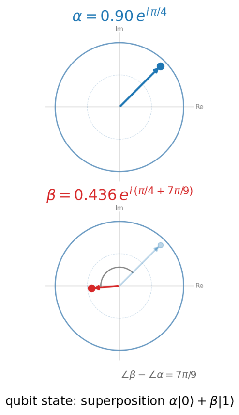
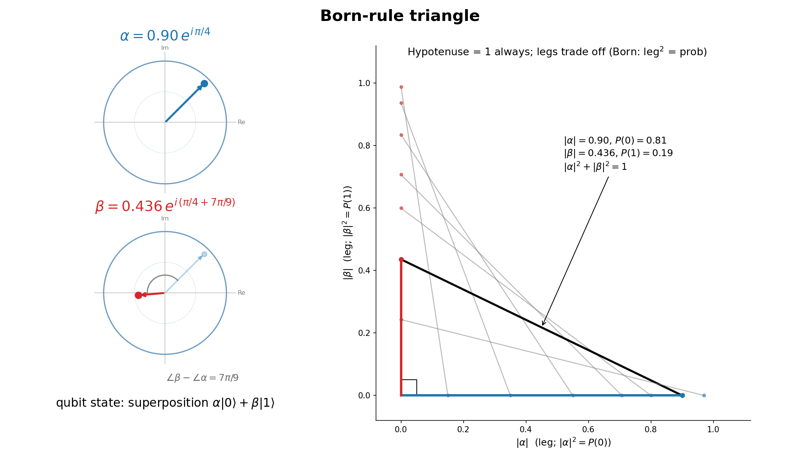
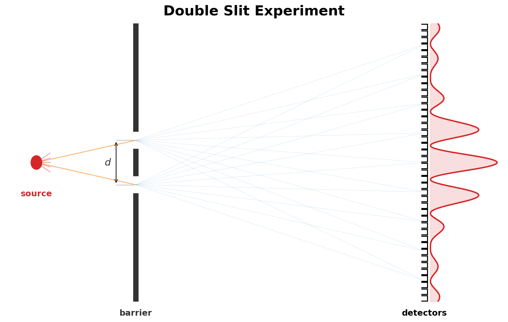
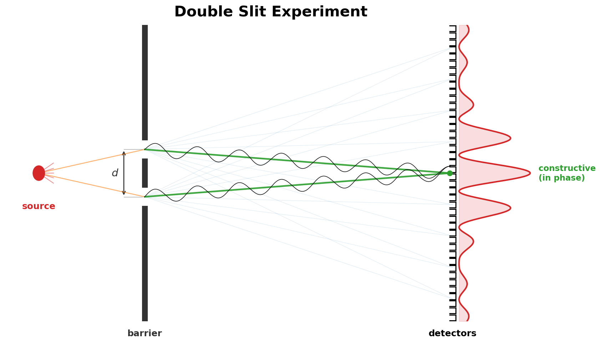
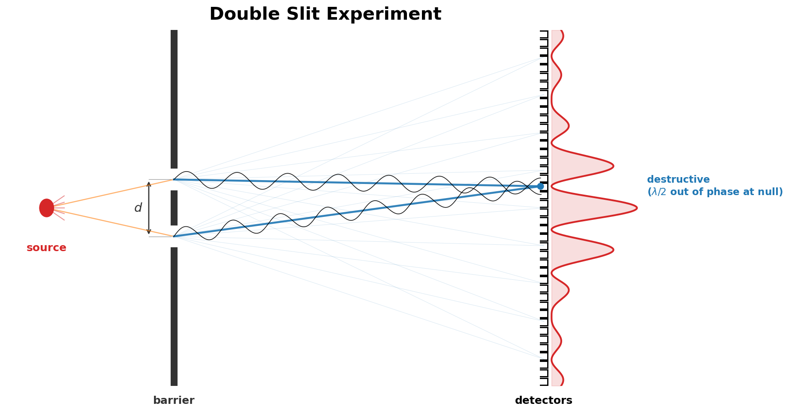
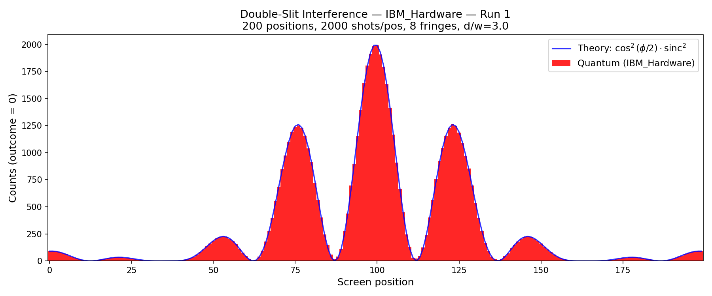
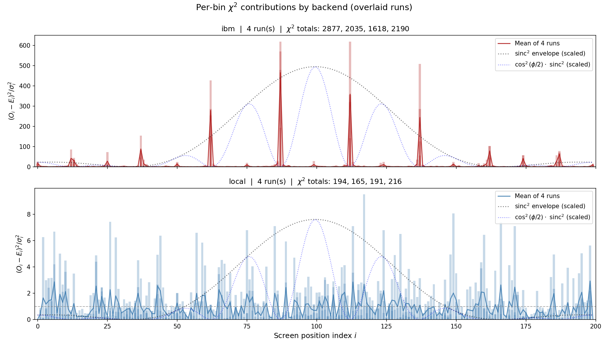
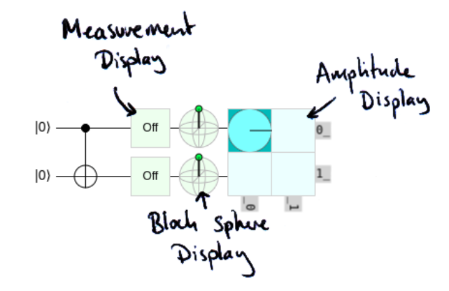
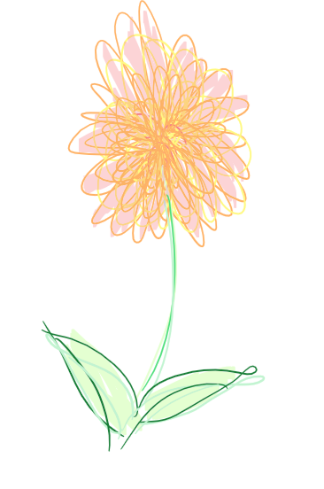

<style>
video {
  display: block;
  margin: 0 auto;
  max-height: 80vh;
  min-width: 60%;
  width: auto;
  height: auto;
}
</style>


# First steps: Quantum Computing on the Cloud

CloudBank Cloud Clinic 20-OCT-2026 (Rob Fatland)


- Physics + Computation perspective
    - Single qubit representation: double slit experiment
- Cloud services perspective
    - Simulation, SDKs, quantum platforms


---

# AI Attribution


Today: Can the AI...


- Teach QM? Not very well
- Baffle? Yes (clues)
- Respond to guesses? Yes
- Invent circuits? No...
- Code circuits? Yes

<br>

This slide deck is a human-designed narrative

---

# From classical to quantum


- H and T (0 and 1): Available states of a flipped coin on a tabletop, **Heads or Tails**

- Quantum Mechanics: Coin exists in a combination of H and T... until we look at it.


<br>

We understand a quantum system in two **stages**: First the system evolves somehow over time. Second we measure its state: H or T, probabilistic.

<br>

We can write conventional laptop code that simulates a quantum system. This is called a quantum *simulator*.


---


# Quantum Computing intersects two fields

- **Quantum mechanics** — jargon: superposition principle, amplitudes, phase, the Born rule, measurement, entanglement
- **Computation** — circuits, gates, sampling, information theory

<br>

Quantum Processing Units (QPUs): Hardware that brings QM and Computation together. Functional QPUs are in the *development phase*; far enough along that we can use them (for a $fee$). 


--- 

# A formalism for a 1-qubit quantum system

<div style="display:flex; align-items:center;">
<div style="flex:0 0 40%; text-align:center;">



</div>
<div style="flex:0 0 60%; font-size:92%;">

Here comes a dash through quantum mechanics to quantum computing.


The simplest quantum system is a single qubit (quantum "coin").


A qubit has two basis states called $|0\rangle$ and $|1\rangle$, *abstract*.


The **state of the system** $|\psi\rangle$ is a sum of these basis states, each multiplied by respective "amount" coefficients: Small $\mathbb{C}$omplex numbers $\alpha$ and $\beta$.


$|\psi\rangle = \alpha \; |0\rangle + \beta \; |1\rangle$


Left: $\alpha$ and $\beta$ on respective unit discs.
<br>

</div>
</div>


---

# Stage 1: The quantum system evolves 


- $\alpha$ and $\beta$ can change over time

- *How* is constrained by mathematical rules

- This amounts to modifying the total state $|\psi\rangle = \alpha |0\rangle + \beta |1\rangle$

- In quantum computing: We have tools called *gates*

- *Gates* modify $\alpha$ and/or $\beta$: evolve the system

---

# Stage 2: Measurement


When we measure the qubit (stage 2), the result will be either $|0\rangle$ or $|1\rangle$.

This is a probabilistic result. What determines the odds?

Answer: *squared magnitudes* of $\alpha$ and $\beta$ give respective probabilities of $|0\rangle$ and $|1\rangle$

<br>

$$P(|0\rangle) = |\alpha|^2, \qquad P(|1\rangle) = |\beta|^2$$

<br>

This is the **Born rule**: The outcome is always one of the two basis states $|0\rangle$ and $|1\rangle$; so the probabilities sum to one: $|\alpha|^2 + |\beta|^2 = 1$.


That matches up with a right triangle: Legs are $|\alpha|$ and $|\beta|$ and hypotenuse = 1.

---





---

# What to call $\alpha$ and $\beta$?

<br>

Born rule: $|\alpha|^2$ is a *probability*. So is $|\beta|^2$.


So what to call $\alpha$? Physicists use the extended term "*probability amplitude*".


This *amplitude* is a precursor to *probability*. We get there via measurement.


---

# The Bloch sphere


The qubit state vector $|\psi\rangle$ is commonly visualized on a single sphere. $\alpha$ and $\beta$ as complex numbers confer four degrees of freedom; but physical constraints reduce this to only two degrees of freedom: Hence $|\psi\rangle$ maps to a point on the surface of a unit sphere, the 'Bloch sphere'.

- Normalization (the Born rule triangle) eliminates one degree of freedom
- The average phase angle of $\alpha$ and $\beta$ has no physical meaning, eliminating another
- Remaining degrees of freedom: The magnitude of $\alpha$ maps to a colatitude angle and the phase *difference* $\angle \beta - \angle \alpha$, an azimuthal (longitudinal) angle.

Bloch sphere representation is more streamlined than $\alpha \beta$-discs.

--- 


<video src="media/C_to_Bloch.mp4" controls autoplay loop muted></video>


---

# Double slit experiment (DSE)


- The DSE requires a series of detectors placed along a detector wall

- We run the experiment "one detector at a time" and compile results by sweeping across the wall

---




--- 



--- 



--- 


# Double Slit Experiment Quantum Circuit

This one-qubit circuit models the DSE. Note that the two-stage sequence is encoded in this diagram. The first stage consists of 3 'evolve' gates H - P - H. The second stage (grey box) measures the wave function to be either $|0\rangle$ or $|1\rangle$.


---


# Sweep the detectors many times

<br>

One qubit measurement: The particle arrives / doesn't arrive at a detector

- **Superposition**: The particle takes both paths
- Relative path lengths result in constructive or destructive interference
- **Measurement**: 'Particle detected?' answered using a random number generator

---
# This circuit as simulator code

```
import numpy as np
from qiskit import QuantumCircuit
from qiskit_aer import AerSimulator

qc = QuantumCircuit(1, 1)
qc.h(0)
qc.p(np.pi / 6, 0)   # 30 degrees
qc.h(0)
qc.measure(0, 0)

result = AerSimulator().run(qc, shots=1).result()
print(result.get_counts())   # e.g. {'0': 1}
```
---

# Repetition: Many shots


- At each screen detector position: Set up a detector, send many particles
- Sweep detector positions to accumulate the fringe pattern.


This makes quantum computing expensive: Run many shots to accumulate the statistics.

---


# Stage 1 > stage 2: 3 detector locations

<video src="media/bloch_dse_animation.mp4" controls autoplay loop muted></video>


---


# Accumulating the Fringe Pattern (IBM Hardware)

<video src="media/dse_accumulate_ibm.mp4" controls autoplay loop muted></video>

---


# Cloud Quantum Hardware


- Real QPUs are reachable today via cloud APIs — pay-as-you-go
- IBM Quantum, AWS Braket, Azure Quantum, Google
- **Simulators first:** free, noiseless, fast — the way to start
- Go to real QPUs once the circuit is proven

<!-- Figure: cloud provider / stack graphic -->

---


# DSE: Simulator vs Real Hardware

- Simulator reproduces the ideal $\cos^2(\varphi/2)$ fringes
- Real hardware adds a noise signature: decoherence, readout error
- The gap between them is the lesson

 


---

# Running on real quantum hardware


- Decoherence (Bloch decay)
- Readout bias (Prefer |0> to |1>)

<br>

Result: Most detectors are not too noisy for this simple circuit; but at the fring peaks and minima $\chi^2$ spikes.

---



---


# Renowned Quantum Algorithms

<div style="font-size:70%;">

| Algorithm | Purpose | Speedup > classical | Qubits |
|---|---|---|---|
| **Shor** | Factoring / discrete log (break public-key schemes) | $O((\log N)^3)$ | 100s–1000s+ |
| **Grover** | Unstructured search over $N$ items | $O(\sqrt{N})$ vs $O(N)$ | 2+ ($\sim\log_2 N$) |
| **Quantum Approximate Optimization Algorithm** | Combinatorial optimization — **the TSP workhorse** | Heuristic; no proven general speedup | 5+ ($\sim n^2$ for $n$-city TSP) |
| **VQE** | Ground-state energy (quantum chemistry) | Heuristic; advantage expected, not proven | 2+ (scales with orbitals) |
| **QFT** | Phase / period estimation (engine inside Shor) | $O((\log N)^2)$ gates vs $O(N\log N)$ FFT | 3+ |

</div>

---

# Algorithm Table — Notes

- **TSP** has no famous standalone quantum algorithm. It is mapped to a QUBO/Ising cost function and fed to **QAOA** (gate model) or quantum annealing (D-Wave). Exact solving can wrap **Grover** around tour-cost checking for a quadratic speedup, but the qubit cost is brutal. Neither beats classical TSP heuristics today.
- **QFT** is listed as the renowned *primitive* — it ties directly to our H-P-H phase-interference circuit. Drop it and Shor / Grover / QAOA / VQE stand as the canonical four.
- Every algorithm here relies on controlled gates and entanglement — a product-state-only circuit is classically simulable, so there is no speedup without them.


---

# Cloud-based quantum systems

<div style="font-size:62%;">

| Provider (cloud) | Modality | Billing model | Rate | 100k-shot cost (H-P-H) |
|---|---|---|---|---|
| **Rigetti** (AWS Braket) | Superconducting | Per-shot + per-task | \$0.000425/shot + \$0.30/task | ~\$42.80 |
| **IonQ Forte** (AWS Braket) | Trapped-ion | Per-shot + per-task | \$0.08/shot + \$0.30/task | ~\$8,000 |
| **IBM** | Superconducting | Per-second runtime | \$1.60/s (\$96/min) | ~\$6  |
| **Quantinuum H2** (Azure) | Trapped-ion | Per-HQC (credits) | ~\$12.50/HQC | ~\$2,060 |
| **Pasqal Fresnel** (Azure) | Neutral-atom (analog) | Per QPU-hour | EUR 3,000/QPU-hour | time-based (est. hours) |

</div>

<div style="font-size:72%;">
<br>
Simple DSE single-qubit circuit: Per-shot providers are exact; IBM / Quantinuum / Pasqal are estimates.

</div>


---
<div style="display:flex; align-items:center;">
<div style="flex:1;">

# Conclusions

- Real QC power: Control gates / entanglement (diagram credit: cnot.io)
- AI-facilitated learning of QC is -+
- Simulators are the (free) entrance path
- IBM QPUs: Very cost effective
- Is QC $\sim$ fusion power?
    - $21 = 3 \times 7$; 5-city TSP
- See 3B1B for more
- As a cloud practitioner: exercise <br> care in working up to $ experiments 

</div>
<div style="flex:1; text-align:center;">



</div>
</div>


---

<div style="display:flex; align-items:center;">
<div style="flex:1;">

Questions? Compliments?

# Thank You

help@cloudbank.org


</div>
<div style="flex:1; text-align:center;">



</div>
</div>

---

# additional material...

- **Single qubit — ok analogy:** Double-slit interference on an H-P-H circuit
- **Two qubits — not there yet** Bell state, entanglement, the Bell/CHSH inequality

---


# Hinting at Entanglement


The DSE is a single-particle phenomenon; its state space is one factor. Entanglement concerns properties of composite systems. For this we join the Hilbert spaces of individual particles by means of a *tensor product* $\otimes$. 

Entanglement requires at least two subsystems whose joint state $|\psi\rangle_{AB}$ cannot be written as a product $|\phi\rangle_A \otimes |\chi\rangle_B$. 

(No single-particle system uses the tensor product formalism.)

---

The term "*Bell/CHSH*" invokes an experiment where quantum mechanics is shown to not follow hidden variable behavior (flipped coins covered by cups).


Entanglement introduces nonlocal correlations: Measurements can resolve in two locations instantaneously (without FTL transmission of information)


Measuring $A$ instantaneously fixes the description of a distant $B$, with correlations (Bell/CHSH) stronger than local-hidden-variable theory allows. The DSE never forces this, because there's only one system to measure.


An entangled pair has a definite joint state while each party, viewed alone, is in a mixed state with no pure state of its own. "Superposition of what?" becomes observer/factorization-dependent.

---

Your Q4.md CHSH material is exactly this second mystery: $|S| = 2\sqrt{2}$ violating the classical bound of 2 is a statement that has no single-particle analog. The DSE can't violate a Bell inequality because Bell inequalities are about correlations between separated subsystems.

---

DSE then Bell are two layers of "departure from classical":

One system, many alternatives → superposition + Born rule. Feynman's "only mystery." Fully contained in the DSE. This is the departure from classical states.
Many systems, one joint state → entanglement + nonlocality. Schrödinger's "characteristic trait." Requires the tensor product; invisible to the DSE. This is the departure from classical composition (the classical assumption that the whole is just the parts plus their local properties).

---

Entanglement doesn't contradict Feynman — it's built from superposition (an entangled state is a superposition in the joint space, e.g. $\frac{1}{\sqrt2}(|00\rangle + |11\rangle)$). So superposition really is the atomic mystery, and the DSE really does carry it. Entanglement is superposition applied to composite systems, which unlocks a new, strictly stronger phenomenon that no single-particle setup — the DSE included — can display.

---

A sharper way to say it: the DSE exhausts the mystery of a single ray in Hilbert space; entanglement is the mystery of how Hilbert spaces combine. Feynman was describing the first; Schrödinger the second. Both "the essential thing," at their own level.

--- 

# Back to the single qubit


- Energy is the Hamiltonian $\hat{H}$ (Hermitian observable, eigenstates $|0\rangle,|1\rangle$)
- The corresponding unitary gate is time evolution 


$$U(t)=e^{-i\hat H t/\hbar}$$


